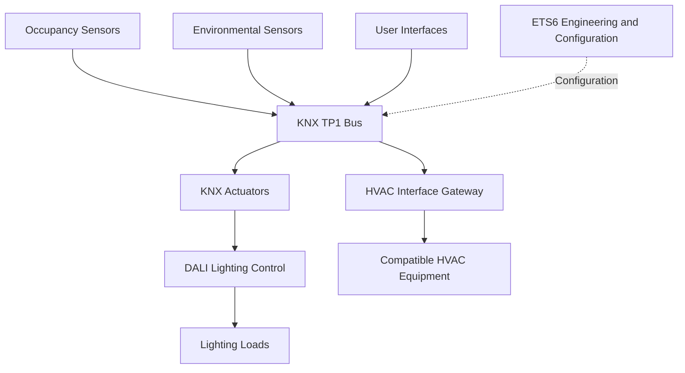

# KNX-Based Smart Building Automation

### Melbourne Building | Conceptual Engineering Design

<p align="center">
  <strong>BUILDING AUTOMATION · ENERGY EFFICIENCY · KNX · DALI · HVAC INTEGRATION</strong>
</p>

<p align="center">
  
  
  
  
</p>

---

## 01. Project Overview

This repository documents a conceptual building automation design developed as part of an Electronic Engineering graduation project at **Universidad Central, Bogotá, Colombia**.

The project explores how a proposed KNX-based building automation architecture could support energy management in a hypothetical multi-level administrative and service building known as the *Melbourne Building*.

The design considers functional zoning, occupancy-aware lighting strategies, daylight-responsive lighting, DALI lighting-control integration, environmental monitoring, user interfaces, and a proposed interface for HVAC equipment.

> **Project status:** Conceptual engineering design. The original academic project does not document a completed physical installation or field measurements validating the projected energy savings.

## 02. Project at a Glance

<table>
  <tr>
    <td align="center" width="33%">
      <h2>1,015.9 m²</h2>
      <sub>Approximate building area</sub>
    </td>
    <td align="center" width="33%">
      <h2>5</h2>
      <sub>Functional zones</sub>
    </td>
    <td align="center" width="33%">
      <h2>24.6%</h2>
      <sub>Projected energy reduction*</sub>
    </td>
  </tr>
</table>

<sub>*Calculated from the annual energy estimates reported in the original academic document. This is a theoretical projection, not a measured or experimentally validated result.</sub>

### Engineering objectives

- Develop a proposed building automation architecture based on KNX.
- Define functional zones and their automation requirements.
- Explore occupancy-aware and daylight-responsive lighting strategies.
- Consider DALI integration for lighting control.
- Propose environmental monitoring and HVAC integration.
- Estimate the potential energy implications of the proposed automation strategies.

## 03. Building and Functional Zones

The conceptual building design considers five primary functional areas.

| Functional zone | Main design consideration |
|---|---|
| Lobby and reception | Lighting control according to use and occupancy |
| Cafeteria | Lighting management in a space with variable occupancy |
| Open-plan collaborative workspaces | Occupancy-aware and daylight-responsive lighting |
| Private administrative offices | User control, lighting scenes, and environmental monitoring |
| Data centre / server room | Continuous operational requirements and environmental monitoring |

These represent proposed functional requirements, not evidence that the corresponding control sequences were commissioned in a physical building.

## 04. Proposed Automation Architecture

The design considers KNX as the building automation backbone, with additional technologies and interfaces for lighting and HVAC functions.

### System architecture



*This diagram illustrates the proposed architecture. It does not establish that the devices were physically connected or that communication with HVAC equipment was tested.*

### Technologies considered

| Technology | Role in the proposed design |
|---|---|
| KNX | Building automation and control architecture |
| KNX TP1 | Proposed twisted-pair communication medium |
| ETS6 | KNX engineering and configuration environment |
| DALI | Proposed lighting-control integration |
| Sensors and user interfaces | Occupancy, environmental monitoring, and user interaction |
| HVAC interface gateway | Proposed integration with compatible HVAC equipment |

The original project report documents proposed device selections, functional layouts, and physical-addressing arrangements. Device references and compatibility should be verified against manufacturer documentation before the design is considered implementation-ready.

## 05. Preliminary Energy Assessment

The original academic report presents a theoretical comparison between a conventional operating scenario and a proposed automated scenario.

### Annual energy estimates

| Scenario | Estimated annual consumption |
|---|---:|
| Conventional operation | 142,000 kWh/year |
| Proposed automated operation | 107,000 kWh/year |
| Estimated difference | 35,000 kWh/year |

The percentage reduction derived from these values is:

\[
\text{Reduction} =
\frac{142{,}000-107{,}000}{142{,}000}
\times 100
\approx 24.65\%
\]

The result is approximately **24.6%, rounded to 25%**.

### Interpretation

The estimates suggest that occupancy-aware lighting strategies and differentiated operating requirements across functional zones could reduce energy consumption under the assumptions used in the original report.

However, the available academic document does not establish that these savings were measured in an operating building. The figures should therefore be interpreted as **projected energy performance**, not experimentally demonstrated savings.

A reproducible energy assessment would require explicit assumptions for installed power, operating schedules, occupancy profiles, control behaviour, HVAC loads, and the calculation of annual energy consumption.

## 06. Supplementary Computational Model

The repository also contains a Python-based hourly model intended to explore the relationship between occupancy assumptions and simplified energy-consumption profiles.

This model must be distinguished from the original academic design.

The current simplified model assigns numerical values to functional zones, applies occupancy factors over a 24-hour schedule, and compares a baseline with an automated scenario. These calculations do not, by themselves, constitute a validated building-energy simulation.

### Model limitations

- Zone values are model inputs and must not be interpreted as verified installed electrical loads without supporting documentation.
- The occupancy profile is simplified and requires justification.
- The current calculation does not independently model HVAC energy consumption or temperature-dependent HVAC behaviour.
- It does not simulate physical KNX bus communication or verify real actuator behaviour.
- Its hourly totals do not establish the annual consumption values reported in the original academic document.

Any computational results should be presented separately, with documented equations, units, assumptions, execution instructions, and reproducible output.

## 07. Scope and Limitations

The original academic project is a conceptual building automation design.

The repository should not be interpreted as evidence of:

- A completed physical KNX installation.
- Field measurements from the Melbourne Building.
- Experimentally validated annual energy savings.
- A commissioned HVAC integration.
- An independently validated financial return on investment.
- An obtained EDGE, LEED, or WELL certification.

The estimated energy figures are taken from the original project report. Any additional economic analysis, simulation, or certification assessment would require its own documented methodology and supporting evidence.

## 08. Repository Structure

```text
smart-building-knx-simulation/
├── README.md
├── energy_model.py
├── main.py
├── results/
├── .gitignore
└── LICENSE
```

- `README.md` — Project overview, technical scope, and limitations.
- `energy_model.py` — Simplified occupancy-based energy model.
- `main.py` — Model execution and graphical comparison.
- `results/` — Supplementary results; available files and contents should be verified.
- `.gitignore` — Git exclusion rules.
- `LICENSE` — Repository licensing terms.

## 09. Running the Supplementary Model

The following instructions apply only to the supplementary Python model, not to the original KNX design work.

### Requirements

- Python 3
- NumPy
- Matplotlib

### Installation

```bash
python -m pip install numpy matplotlib
```

### Execution

From the repository root, run:

```bash
python main.py
```

The script calculates the model's baseline and occupancy-adjusted totals and displays a comparison plot.

The output should be interpreted according to the model's assumptions. It must not be presented as a reproduction of the annual estimates in Section 05 unless a documented calculation establishes a valid relationship between the two.

Academic Project and Repository Authorship

The original academic project, KNX Automation Project — Melbourne Building, was developed collaboratively by Daniel Felipe Villegas Castellanos and Santiago Guarnizo Domínguez as part of the undergraduate Electronic Engineering program at Universidad Central, Colombia (November 2025).

This GitHub repository is an individual follow-up project maintained by Daniel Felipe Villegas Castellanos. Its documentation, repository structure, and supplementary Python-based modeling work are separate from the original academic deliverables, unless otherwise explicitly stated.

The original project is a conceptual KNX-based building automation design. The supplementary Python model is intended for illustrative analysis and should not be interpreted as a reproduction or experimental validation of the original project's energy calculations.

Credit for the original academic work is acknowledged to both contributors. Any use or adaptation of original materials remains subject to the applicable authorship rights and permissions.

## 10. Future Engineering Work

Potential next steps include:

1. Audit the selected devices and verify their specifications against manufacturer documentation.
2. Complete the proposed KNX group-addressing and functional-control documentation.
3. Define explicit electrical loads, schedules, and occupancy assumptions for the energy assessment.
4. Develop and test a reproducible energy model with consistent units.
5. Separate lighting-energy calculations from HVAC-energy calculations.
6. Validate the model against a suitable reference case or measured data, if available.
7. Evaluate the design through a physical installation or an appropriate test environment.

## 11. Original Academic Project

**Project title:** KNX Automation Project — Melbourne Building  
**Authors:** Daniel Felipe Villegas Castellanos

**Institution:** Universidad Central, Bogotá, Colombia  
**Date:** November 2025  
**Academic context:** Electronic Engineering graduation project completed through the thematic advanced course *Automation and Control of Smart and Sustainable Buildings*.

The repository complements the original conceptual engineering design. Additional computational work should be treated as a separate extension unless its relationship to the original project is explicitly documented.

---

<p align="center">
  <strong>Daniel Felipe Villegas Castellanos</strong><br>
  Electronic Engineer · Building Automation · Control Systems
</p>

<p align="center">
  KNX · ETS6 · DALI · Smart Buildings · Energy Efficiency
</p>
